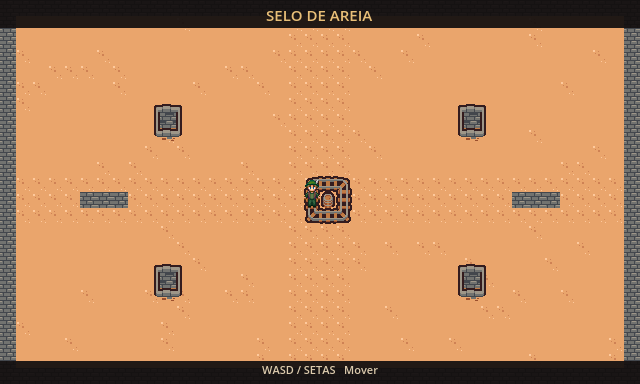

# Selo de Areia

Um explorador preso em um templo perdido enfrenta ondas de múmias lentas. No jogo final, precisará resistir até o despertar do guardião e derrotá-lo.

Projeto de **Jogos Digitais II — 2026/2**, desenvolvido em Godot 4.7.2, com renderizador **Compatibility**.

## A carta

| Campo | Definição |
| --- | --- |
| Tema | Templo perdido com múmias lentas |
| Tipo sorteado | Chefe |
| Modo escolhido | Horda: arena 2D vista de cima |
| Objetivo final | Resistir às ondas até o chefe surgir e derrotá-lo |

## Estado desta etapa

**Aula 08 — 07/10:** arena fechada de 640 × 384 pixels, chão e objetos em camadas separadas, obstáculos sólidos e personagem animado em quatro direções. Esta etapa ainda não possui inimigos nem condições de vitória ou derrota.

A vila do exercício foi adaptada para o templo do projeto. O mapa mantém 40 × 24 peças de 16 pixels. A câmera é filha do jogador e tem limites nas bordas; seu zoom é 1 para mostrar a arena inteira, conforme o modo Horda. A janela abre ampliada para 1280 × 768, com filtro Nearest e escala inteira.

## Como abrir e jogar

1. Clone este repositório.
2. No gerenciador da Godot 4.7.2, escolha **Importar** e selecione `project.godot`.
3. Abra o projeto e pressione **F5**.

| Controle | Ação |
| --- | --- |
| WASD ou setas | Mover o explorador |

## Organização

- `scenes/`: arena e, nas próximas etapas, telas de fim.
- `entities/`: personagem e demais entidades reutilizáveis.
- `scripts/`: comportamento em GDScript.
- `tiles/`: TileSet compartilhado pelas camadas do mapa.
- `sprites/`: arte e licenças.
- `docs/`: capturas de tela.
- `DEVLOG.md`: decisões, dificuldades e soluções por aula.

## Histórico das aulas

| Tag | Data da aula | Conteúdo |
| --- | --- | --- |
| `aula-08` | 07/10/2026 | Arena, colisão e personagem em quatro direções |

Para abrir uma etapa antiga sem alterar a cópia de trabalho atual, crie outra pasta: `git worktree add ../selo-aula-08 aula-08`.

As datas acima identificam as aulas. A implementação começou em **28/10/2026**; os commits mantêm suas datas reais.

## Créditos e fontes

- Base didática: roteiros das aulas 08 e 09 e enunciado do projeto, do Prof. Ezéfferth C. A. Fernandes, Jogos Digitais II.
- Código: adaptado e implementado com auxílio de **OpenAI Codex**. Cada script registra essa origem no início. O código deve ser estudado e compreendido para a apresentação.
- Cenário: [Tiny Dungeon, por Kenney](https://kenney.nl/assets/tiny-dungeon), licença [CC0](https://creativecommons.org/publicdomain/zero/1.0/). Recortes no TileSet e coloração quente dos objetos pela Godot.
- Explorador: `Ranger-M-01`, do pacote [24x32 characters with faces, por Svetlana Kushnariova (Cabbit)](https://opengameart.org/content/24x32-characters-with-faces-big-pack), contato exigido pela autora: **lana-chan@yandex.ru**. Licença [CC BY 3.0](https://creativecommons.org/licenses/by/3.0/). Recortes de animação e remoção do fundo por material de chave de cor na Godot.

Os PNGs originais foram preservados. O material `sprites/retirar_fundo.gdshader` torna uma cor de fundo transparente durante a renderização, sem alterar as imagens. As fontes completas e as cópias das licenças estão em `sprites/`.
